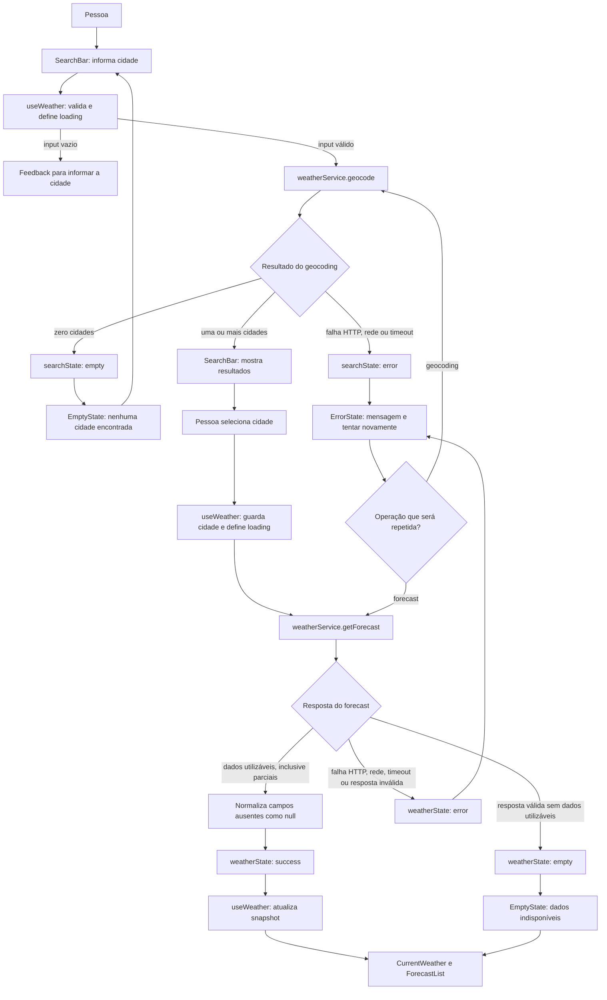

# Plano Técnico — Weather App

## Architecture

Aplicação SPA em React. A interface usa componentes de apresentação; um hook de página coordena busca, seleção de cidade, consulta meteorológica e unidade; serviços isolam as chamadas HTTP e normalizam as respostas da Open-Meteo. Funções puras cuidam de conversão, formatação e descrição dos códigos meteorológicos.

## Tech Stack

- React e TypeScript, com Vite, conforme o projeto.
- Tailwind CSS para interface responsiva.
- `fetch` nativo, `AbortController` para timeout e cancelamento; sem cliente HTTP adicional.
- Vitest e Testing Library para testes unitários e de componentes; Playwright para fluxos E2E.
- Open-Meteo para geocoding e previsão, sem API key.

## Project Structure

```text
src/
  components/       # SearchBar, resultados, clima atual, previsão, unidade e estados
  hooks/            # useWeather: coordenação da experiência e requisições
  services/         # cliente e normalização das respostas Open-Meteo
  types/            # City, WeatherSnapshot, CurrentWeather e DailyForecast
  lib/              # temperatura, datas, códigos meteorológicos e formatos
  styles/           # estilos globais e Tailwind
tests/
  unit/             # serviços, conversão, formatação e componentes
  e2e/              # busca, consulta, alternância e falhas
```

## Data Model

O estado interno usa Celsius, mm para precipitação e km/h para vento. Valores que o provedor não retornar são `null` e a interface os apresenta como “Indisponível”, exceto precipitação atual explicitamente nula, normalizada para `0 mm`.

```ts
type TemperatureUnit = "celsius" | "fahrenheit";

interface City {
  id?: number;
  name: string;
  admin1?: string;
  country?: string;
  latitude: number;
  longitude: number;
  timezone: string;
}

interface CurrentWeather {
  weatherCode: number | null;
  temperatureC: number | null;
  apparentTemperatureC: number | null;
  relativeHumidityPercent: number | null;
  precipitationMm: number | null;
  windSpeedKmh: number | null;
  surfacePressureHpa: number | null;
}

interface DailyForecast {
  date: string; // YYYY-MM-DD no fuso local da cidade
  weatherCode: number | null;
  minTemperatureC: number | null;
  maxTemperatureC: number | null;
  precipitationProbabilityMaxPercent: number | null;
}

interface WeatherSnapshot {
  city: City;
  current: CurrentWeather;
  forecast: DailyForecast[]; // cinco datas
}
```

## Data Flow

1. A pessoa envia a busca; o app remove espaços externos e não envia input vazio.
2. O serviço consulta geocoding e apresenta cidade, região e país quando disponíveis.
3. A pessoa seleciona um resultado; coordenadas e fuso retornados identificam a cidade.
4. O serviço de previsão busca clima atual e cinco previsões diárias em uma única resposta.
5. O serviço normaliza unidades e dados ausentes; o hook atualiza a tela.
6. A unidade escolhida é lida ou salva em `localStorage`; a conversão de temperatura ocorre na apresentação.



## External APIs

- **Geocoding:** `https://geocoding-api.open-meteo.com/v1/search`, usando nome enviado, `count=10`, idioma português e formato JSON.
- **Forecast:** `https://api.open-meteo.com/v1/forecast`, com latitude/longitude, dados atuais `temperature_2m`, `apparent_temperature`, `relative_humidity_2m`, `precipitation`, `weather_code`, `wind_speed_10m` e `surface_pressure`; campos diários definidos acima; `temperature_unit=celsius`, `wind_speed_unit=kmh`, `precipitation_unit=mm`, `timezone=auto` e `forecast_days=5`.
- Não enviar identificadores de usuário. Exibir atribuição à Open-Meteo. Confirmar parâmetros, cobertura, limites e atribuição exigida ao validar o contrato do provedor.

## State Management

O estado da tela vive em um único hook de domínio, `useWeather`; não é necessário store global. Componentes recebem estado e callbacks por props, e não acessam serviços diretamente. O hook mantém os estados de busca e de previsão separados, a consulta atual, as cidades encontradas, a cidade selecionada, o snapshot meteorológico e a unidade escolhida.

Cada operação assíncrona usa o mesmo conjunto explícito de estados:

```ts
type AsyncState<T> =
  | { status: "idle" }
  | { status: "loading" }
  | { status: "success"; data: T }
  | { status: "empty" }
  | { status: "error"; error: WeatherError };

type WeatherError = {
  kind: "network" | "api" | "timeout" | "invalid-response";
  message: string;
  retryable: boolean;
};
```

- `searchState: AsyncState<City[]>`: `idle` antes da busca; `loading` durante geocoding; `success` quando há resultados; `empty` quando a API responde com zero cidades; `error` para falha.
- `weatherState: AsyncState<WeatherSnapshot>`: `idle` sem cidade selecionada; `loading` durante a consulta; `success` quando há dados meteorológicos utilizáveis, inclusive resposta parcial; `empty` quando uma resposta válida não contém nenhum dado utilizável; `error` para falha da consulta.
- `selectedCity` e `query` permanecem no hook para permitir edição e retry da mesma operação. Novas consultas cancelam as anteriores; cancelamento por substituição não aparece como erro para a pessoa.
- `unit: TemperatureUnit` é estado independente dos estados assíncronos. Inicializar por `localStorage` ou, se não houver valor válido, em Celsius. Persistir somente a unidade; se o armazenamento estiver indisponível, manter a escolha em memória.

Temperaturas recebidas e armazenadas em `WeatherSnapshot` ficam sempre em Celsius. A camada de apresentação deriva o valor no render: Celsius usa o valor original; Fahrenheit calcula `valueC * 9 / 5 + 32`. A conversão é uma função pura de `lib/temperature.ts`; não altera o snapshot, não dispara nova consulta e é recalculada quando `unit` muda.

## Error Handling

- **Input vazio:** validar antes do serviço; não enviar geocoding e manter uma solicitação para informar o nome da cidade.
- **Nenhum resultado:** geocoding bem-sucedido com lista vazia é `empty`, não erro. Mostrar estado sem resultados e preservar a busca para edição.
- **Falha de rede:** classificar rejeição de `fetch` (exceto abort explícito) como `network`; mostrar mensagem de conexão e ação manual de retry.
- **Erro da API:** resposta HTTP não-2xx é `api`; incluir status HTTP no erro técnico, apresentar mensagem amigável e permitir retry manual.
- **Timeout:** após 10 segundos, abortar a requisição e classificar como `timeout`; mostrar mensagem específica e permitir retry. Aborts causados por uma busca mais nova são silenciosos.
- **Resposta inválida:** JSON ilegível ou estrutura incompatível com o contrato é `invalid-response`; não renderizar o payload como dados válidos e oferecer retry manual.
- **Resposta parcial:** campos individuais ausentes/nulos são normalizados como `null`, exceto `current.precipitation: null`, que é normalizado para `0`. Preservar os demais campos e apresentar “Indisponível” para os valores ausentes; nunca reutilizar dado anterior. Uma resposta parcial utilizável continua em `success`; sem nenhum dado meteorológico utilizável, usar `empty`.
- **Retry e limpeza:** não fazer retries automáticos nem cache. Cada acionamento de “Tentar novamente” executa uma tentativa da mesma operação; limpar o erro ao iniciar e sempre encerrar `loading` em sucesso, vazio, falha ou timeout.
- **Concorrência:** cancelar ou ignorar respostas de requisições substituídas para impedir que resultados antigos sobrescrevam a cidade atualmente selecionada.

## Testing Strategy

- **Vitest — funções puras:** testar conversão Celsius/Fahrenheit (0 °C → 32 °F, 20 °C → 68 °F, valores fracionários e `null`), formatação pt-BR, códigos WMO conhecidos/desconhecidos e normalização de arrays diários para cinco objetos, incluindo campos ausentes e arrays desalinhados.
- **Vitest — services:** substituir `fetch` por mocks; cobrir URLs/parâmetros, geocoding com resultados e vazio, respostas válidas e parciais, HTTP não-2xx, JSON inválido, rejeição de rede, timeout aos 10 segundos e cancelamento. Nenhum teste unitário chama Open-Meteo real.
- **Vitest + Testing Library — componentes:** validar estados `idle`, `loading`, `success`, `empty` e `error`; busca vazia, seleção de cidade, dados meteorológicos e ausentes, alternância de unidade e ação de retry. Usar `getByRole`/`getByLabelText` e `userEvent`, verificando feedback acessível.
- **Vitest — hook `useWeather`:** simular service para transições dos estados, nova tentativa, persistência/fallback da unidade e resposta antiga cancelada/ignorada quando uma busca mais nova começa.
- **Playwright — E2E:** validar busca → seleção → clima atual/previsão, cidade sem resultados, troca de unidade sem nova chamada de forecast, erro com retry e timeout. Interceptar chamadas com `page.route` e fixtures determinísticas; não depender da API externa.
- **Viewports e acessibilidade:** repetir os fluxos principais em 320, 375, 768 e 1280 CSS px. Validar operação por teclado, foco visível, ausência de rolagem horizontal e anúncio de loading/erro. Se as metas p95 forem aprovadas, medir em ambiente fixo e separado do tempo do provedor.

## Risks & Trade-offs

| Decisão | Trade-off | Alternativas consideradas |
|---|---|---|
| Open-Meteo sem API key | Sem custo/gestão de segredo para o MVP, mas disponibilidade, limites e cobertura ficam sob controle do provedor. | API comercial com SLA e suporte, ao custo de chave, cadastro e possível cobrança. |
| `fetch` nativo | Menos dependências; exige tratamento explícito de status HTTP, timeout, cancelamento e parsing. | Axios ou cliente HTTP, que abstraem parte do fluxo, mas aumentam dependências para apenas dois endpoints. |
| Estado local em `useWeather` | Simples e suficiente para uma tela/fluxo; estado compartilhado entre páginas exigiria elevação/refatoração. | Store global (Redux/Zustand), não justificado para o escopo sem múltiplas áreas de estado. |
| Celsius como unidade canônica; Fahrenheit derivado na renderização | Conversão imediata sem nova chamada e sem divergência entre valores armazenados; requer funções puras e rótulos corretos. | Solicitar ao provedor a unidade selecionada, o que introduziria requests e duplicaria estado/dados. |
| Sem cache ou retry automático | Evita dados meteorológicos vencidos e comportamentos ocultos; falhas dependem de ação manual e o app exige rede. | Cache HTTP/app ou retry automático, que melhorariam resiliência, mas exigiriam validade, invalidação e regras de backoff fora do MVP. |
| Previsão diária por cinco datas | Interface e modelo simples, alinhados ao MVP; não atende planejamento intradiário. | Previsão horária, com mais volume de dados e complexidade visual, sem requisito aprovado. |

A Open-Meteo continua sendo uma dependência externa e sua indisponibilidade deve ser distinguida das falhas da aplicação. Os limites de disponibilidade e desempenho da spec ainda requerem aprovação do método de medição antes de se tornarem critérios de release.